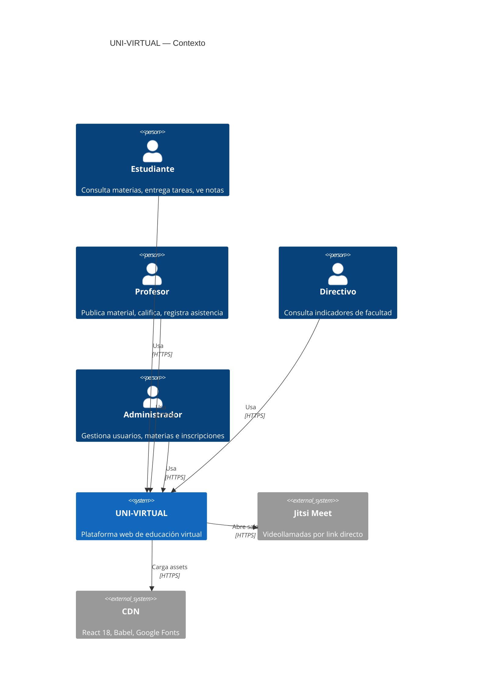
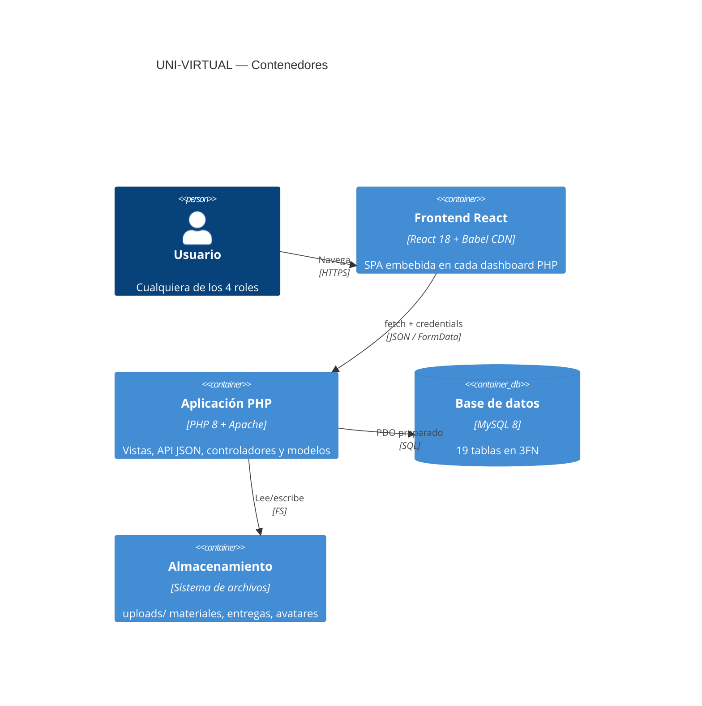
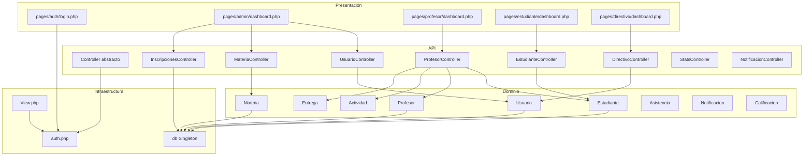
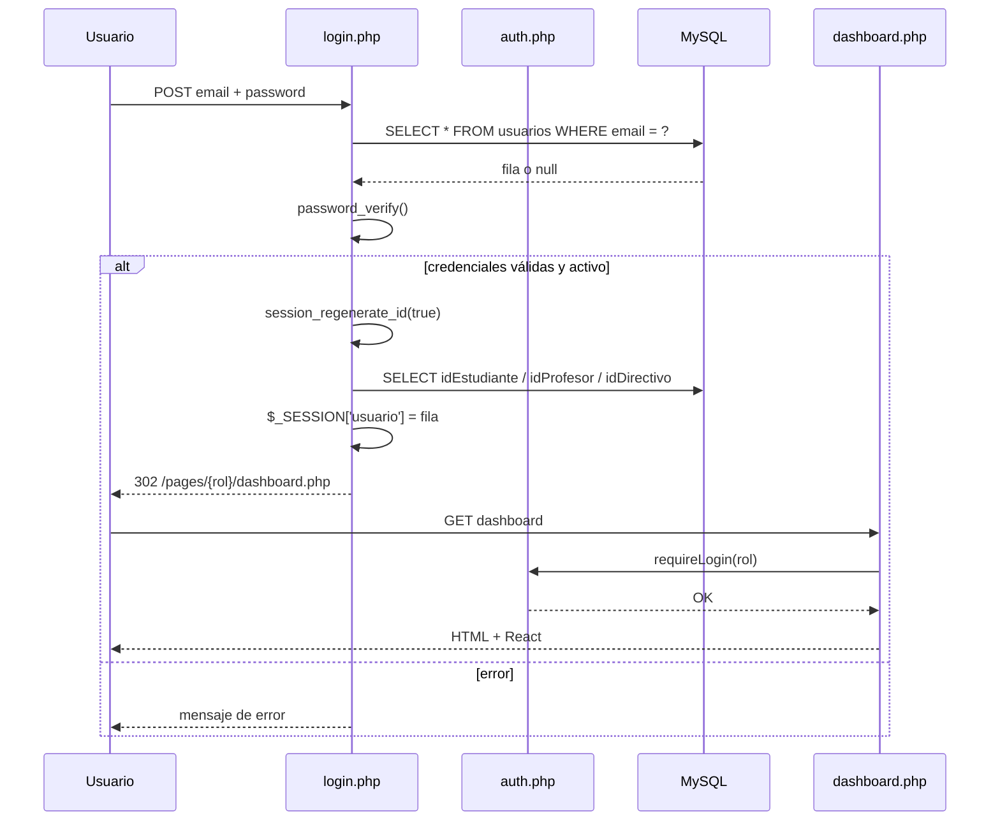

# Arquitectura — UNI-VIRTUAL

| Campo | Valor |
|---|---|
| Documento | Arquitectura de software |
| Versión | 1.0 |
| Fecha | 29 de octubre de 2026 |
| Alcance | Historias vencidas (sprints 1–2) + avance anticipado del Sprint 3 |
| Patrón base | MVC en tres capas + API JSON |
| Stack | PHP 8 · MySQL 8 · React 18 CDN · Apache/XAMPP |

---

## 1. Objetivos de la arquitectura

1. **Separar responsabilidades** entre presentación, API, dominio y datos.
2. **Permitir que cada rol tenga su propio panel** sin duplicar la lógica de negocio.
3. **Exponer una API JSON uniforme** que el frontend React consuma con sesión.
4. **Mantener el despliegue simple**: copiar la carpeta en `htdocs`, importar la BD y abrir el navegador.
5. **Dejar rastro documental** de las decisiones para facilitar el mantenimiento.

### Atributos de calidad priorizados

| Atributo | Prioridad | Cómo se aborda |
|---|---|---|
| Seguridad | Alta | Bcrypt, sesión PHP, control de rol, consultas preparadas. |
| Mantenibilidad | Alta | MVC, modelos por entidad, documento de ADRs. |
| Usabilidad | Alta | Dashboards por rol, design system compartido. |
| Portabilidad | Media | XAMPP/LAMP, configuración por constantes. |
| Rendimiento | Media | Índices, consultas acotadas, SPA sin recarga. |
| Escalabilidad | Baja (académico) | Monolito suficiente para el alcance. |

---

## 2. Vista de contexto (C4 — nivel 1)



---

## 3. Vista de contenedores (C4 — nivel 2)



### Contenedores y responsabilidades

| Contenedor | Ruta | Responsabilidad |
|---|---|---|
| Vistas PHP | `pages/` | Renderizan el HTML, inyectan `window.__S` y montan React. |
| API JSON | `api/v1/` | Reciben requests, autorizan, orquestan modelos y responden JSON. |
| Modelos | `models/` | Encapsulan el acceso a datos por entidad. |
| Infraestructura | `includes/` | `auth.php`, `View.php`, utilidades, FPDF, XLSX. |
| Configuración | `config/` | Constantes, `db()` singleton, `notificar()`, autoload. |
| Frontend | `pages/*/dashboard.php` | Componentes React y llamadas a la API. |
| Estilos | `assets/css/` | `main.css` y `panel.css` (design system). |
| Archivos | `uploads/` | Materiales, entregas, avatares, reportes. |
| Pruebas | `tests/`, `test-files/` | Selenium, API y E2E. |

---

## 4. Vista de componentes (C4 — nivel 3)



---

## 5. Arquitectura en capas

### 5.1 Capa de presentación

- **Vistas PHP** (`pages/`) que extienden `View` (Template Method).
- **React SPA** embebida en cada vista con `<script type="text/babel">`.
- **Design system** en `assets/css/panel.css`: variables, sidebar, tarjetas, tablas, badges, modales.
- **Sesión inyectada** como `window.__S` para evitar un request extra.

### 5.2 Capa de API

- Un archivo por dominio en `api/v1/`.
- Todos extienden `Controller`.
- `handle()` lee el método HTTP, el `action` y despacha.
- Respuestas uniformes con `ok()` y `error()`.
- Autorización con `requireAuth(['rol'])`.

### 5.3 Capa de dominio / datos

- `models/` contiene una clase por entidad.
- `Model` abstracto provee `find`, `findAll`, `save`, `delete`.
- Las consultas específicas viven en cada modelo.
- `db()` es un Singleton PDO con `ERRMODE_EXCEPTION` y `FETCH_ASSOC`.

### 5.4 Infraestructura transversal

- `includes/auth.php`: sesión, roles, helpers (`notificar`, `timeAgo`, `formatBytes`).
- `includes/View.php`: Template Method para vistas.
- `config/config.php`: constantes, PDO, autoload y helpers globales.
- `uploads/.htaccess`: bloquea ejecución de scripts.

---

## 6. Patrones de diseño aplicados

| Patrón | Dónde | Propósito |
|---|---|---|
| **Singleton** | `db()` en `config/config.php` | Una sola conexión PDO por request. |
| **Template Method** | `View::__construct` + `render()` | Flujo común de sesión/initials y render propio. |
| **Template Method** | `Controller` | Headers, auth y respuesta comunes. |
| **MVC** | `pages` / `api` / `models` | Separación de responsabilidades. |
| **Composite** | `mensajes.idPadre` | Árbol de respuestas de foro. |
| **Front Controller (ligero)** | `api/v1/*.php` | Un punto de entrada por dominio. |
| **Active Record (parcial)** | `models/*` | Cada modelo conoce su tabla y operaciones. |
| **DTO / JSON** | `ok()` / `error()` | Contrato uniforme de respuesta. |
| **Strategy (implícito)** | `match($action)` | Despacho de acciones por caso. |

### Por qué no hay framework

El proyecto se ejecuta en XAMPP sin Composer y sin Node.js. Un framework añadiría dependencias y complejidad de despliegue. La arquitectura reproduce los conceptos esenciales (MVC, front controller, PSR-ish autoload) con PHP nativo.

---

## 7. Flujos clave

### 7.1 Login



### 7.2 Request típico a la API

```text
React fetch('/api/v1/profesor.php?action=dashboard&idProf=1', {credentials:'include'})
  → Apache enruta al archivo PHP
  → ProfesorController::__construct() → headers + config
  → handle() → requireAuth('profesor')
  → idProf desde sesión
  → dashboard() consulta MySQL con PDO
  → ok([...]) → JSON {status:'ok', data:{...}}
  → React setState y renderiza
```

### 7.3 Inscripción con validación de créditos

```text
Admin → POST /api/v1/inscripciones.php {idEstudiante, idMateria}
  → requireAuth('admin')
  → verifica duplicado
  → lee creditos_minimos de la materia
  → lee creditos_aprobados del estudiante
  → si creditos_aprobados < creditos_minimos → error 400
  → INSERT en inscripciones
  → notificar(idUsuario, 'Inscripción confirmada', ...)
  → ok({idInscripcion})
```

### 7.4 Registro de nota

```text
Profesor → POST /api/v1/profesor.php {action:'guardar_nota', idEstudiante, idMateria, campo, nota}
  → requireAuth('profesor')
  → valida campo permitido
  → normaliza nota 0..5
  → UPDATE inscripciones SET {campo} = ?
  → notificar al estudiante
  → ok(null, 'Nota guardada')
```

---

## 8. Arquitectura de seguridad

| Control | Implementación | Archivo |
|---|---|---|
| Hash de contraseña | `password_hash(PASSWORD_BCRYPT)` | `models/Usuario.php` |
| Verificación | `password_verify` | `pages/auth/login.php` |
| Sesión segura | `session_regenerate_id(true)` | `pages/auth/login.php` |
| Autorización por rol | `requireLogin`, `requireNivel`, `requireAuth` | `includes/auth.php`, `api/v1/Controller.php` |
| Consultas preparadas | PDO `prepare`/`execute` | modelos y controladores |
| Escapado de salida | `htmlspecialchars` en login | `pages/auth/login.php` |
| Uploads no ejecutables | `.htaccess` | `uploads/.htaccess` |
| CORS restringido | `Access-Control-Allow-Origin: http://localhost` | `api/v1/Controller.php` |
| Anti timing attack | retardo mínimo de 250 ms | `pages/auth/login.php` |

### Deuda de seguridad identificada

- No hay token CSRF explícito en formularios.
- No hay rate limiting en login.
- No hay `password_needs_rehash`.
- CORS está fijado a `http://localhost`, no a `BASE_URL`.
- La API no valida `Origin` ni `Referer`.

Se abordan en el Sprint 4 (UV-34) y en el refactor.

---

## 9. Arquitectura del frontend

### 9.1 Composición

Cada dashboard es un archivo PHP que:

1. Extiende `View` y valida sesión.
2. Renderiza el `<head>` con `panel.css` y fuentes.
3. Inyecta `window.__S` y `window.API`.
4. Define componentes React en `<script type="text/babel">`.
5. Monta la app con `ReactDOM.createRoot`.

### 9.2 Convenciones

- Renderizado condicional con `{vista === 'x' && <Componente />}`.
- `fetch` siempre con `credentials: 'include'`.
- Helper `api` con `get`, `post`, `put`, `del`.
- Navegación por estado (`vista`), no por rutas.
- Componentes visuales: `Modal`, `Alert`, `Spinner`, `StatCard`, `Badge`.

### 9.3 Deuda

- Los componentes comunes están duplicados en cada dashboard.
- No hay carpeta `assets/js/components/`.
- El `api` helper se redefine en cada archivo.
- Algunas vistas usan estilos inline.

**Propuesta:** extraer `assets/js/core/api.js`, `components.js` y `ui.css` en el refactor, manteniendo React por CDN.

---

## 10. Despliegue

### 10.1 Topología local

```text
C:\xampp\htdocs\univirtual\
├── Apache (puerto 80)
├── MySQL (puerto 3307)
├── PHP 8.2
└── Navegador → http://localhost/univirtual
```

### 10.2 Topología productiva sugerida

```text
Internet
  │
  ▼
Apache/Nginx + PHP-FPM
  │
  ├── MySQL 8 (red privada)
  ├── uploads/ (volumen persistente)
  └── HTTPS (Let's Encrypt)
```

### 10.3 Variables de configuración

| Constante | Valor local | Observación |
|---|---|---|
| `DB_HOST` | `127.0.0.1` | Evita resolución IPv6 de `localhost`. |
| `DB_PORT` | `3307` | XAMPP de la instalación. |
| `DB_NAME` | `univirtual` | |
| `DB_USER` | `root` | |
| `DB_PASS` | `''` | |
| `BASE_URL` | `http://localhost/univirtual` | Debe parametrizarse en producción. |
| `BASE_PATH` | `realpath(__DIR__.'/..')` | |

---

## 11. Decisiones y trade-offs

| Decisión | Alternativa descartada | Trade-off |
|---|---|---|
| React por CDN | Build con Vite/Webpack | Menos tooling, más peso en runtime. |
| Sesión PHP | JWT | Más simple, pero acoplado al dominio. |
| Monolito MVC | Microservicios | Menos complejidad, menos escalabilidad horizontal. |
| MySQL 8 | PostgreSQL | Disponible en XAMPP. |
| Jitsi link directo | iframe | Sin cuenta, pero sin control de sala. |
| Modelos Active Record | Repository + Unit of Work | Menos capas, más acoplamiento. |

---

## 12. Desviaciones conocidas

| Desviación | Impacto | Acción |
|---|---|---|
| Código usa `archivoEntrega`; esquema v8 usa `urlArchivo`. | Entregas y calificación pueden fallar. | Unificar a `urlArchivo`. |
| `usuarios.php` usa `programa` y `programas_academicos`. | Crear estudiante falla. | Usar `idCarrera` y `carreras`. |
| Formulario envía `codigoEst`; API espera `codigo`. | Crear estudiante/profesor falla. | Alinear contrato. |
| Semestre fijo a 2026-I. | Métricas desactualizadas. | Leer de `configuracion`. |
| Componentes React duplicados. | Mantenimiento costoso. | Extraer shared components. |

El detalle y el plan están en `05-entrega/riesgos-y-deuda.md`.

---

## 13. Índice de ADRs

| ADR | Decisión |
|---|---|
| ADR-001 | Jitsi Meet como link directo, no iframe. |
| ADR-002 | `Controller` en `api/v1/`, no en `includes/`. |
| ADR-003 | La sesión guarda la fila completa del usuario. |
| ADR-004 | React por CDN, sin build step. |
| ADR-005 | Renderizado condicional con `&&`, no `switch`. |
| ADR-006 | MySQL en puerto 3307. |
| ADR-007 | CRUD base en `Model` + consultas específicas por modelo. |
| ADR-008 | `fetch` con `credentials: 'include'`. |
| ADR-009 | Bcrypt solo con `password_hash()` del proyecto. |
| ADR-010 | Contrato JSON uniforme. |
| ADR-011 | Esquema v8 como fuente de verdad. |
| ADR-012 | Documentación viva dentro del repositorio. |

Ver `ADRs.md`.

---

## 14. Conclusión

La arquitectura es **suficiente y coherente** para el alcance académico: monolito MVC, API JSON, React sin build y MySQL normalizado. Su principal riesgo no es el diseño, sino la **deriva entre el esquema v8 y el código heredado**. La siguiente fase debe cerrar esa brecha antes de añadir funcionalidades de los sprints 3 y 4.
