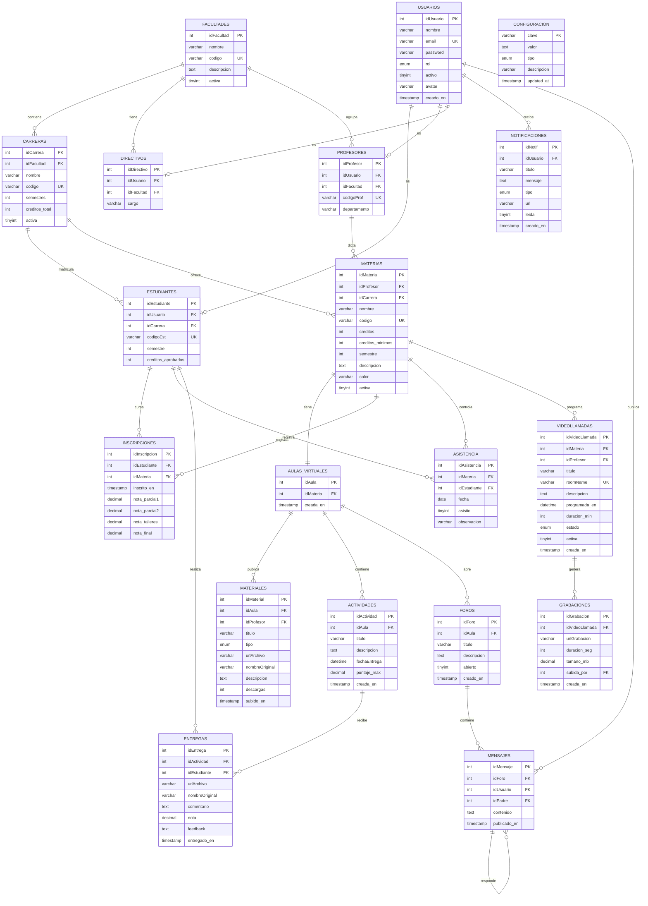

# Modelo de datos — UNI-VIRTUAL

| Campo | Valor |
|---|---|
| Motor | MySQL 8.0+ / MariaDB 10.6+ |
| Script | `config/database_v8.sql` |
| Tablas | 19 |
| Normalización | Tercera forma normal (3FN) |
| Codificación | `utf8mb4` / `utf8mb4_unicode_ci` |
| Fecha | 29 de octubre de 2026 |

---

## 1. Diagrama entidad-relación



---

## 2. Inventario de tablas

| # | Tabla | Propósito | Clave primaria |
|---:|---|---|---|
| 1 | `configuracion` | Parámetros globales clave-valor. | `clave` |
| 2 | `usuarios` | Identidad y rol de toda persona. | `idUsuario` |
| 3 | `facultades` | Unidades académicas. | `idFacultad` |
| 4 | `carreras` | Programas por facultad. | `idCarrera` |
| 5 | `directivos` | Perfil del rol directivo. | `idDirectivo` |
| 6 | `estudiantes` | Perfil académico del estudiante. | `idEstudiante` |
| 7 | `profesores` | Perfil docente. | `idProfesor` |
| 8 | `materias` | Asignaturas y requisitos. | `idMateria` |
| 9 | `inscripciones` | Matrícula y notas. | `idInscripcion` |
| 10 | `aulas_virtuales` | Aula asociada a una materia. | `idAula` |
| 11 | `materiales` | Recursos del aula. | `idMaterial` |
| 12 | `actividades` | Tareas y evaluaciones. | `idActividad` |
| 13 | `entregas` | Respuesta del estudiante a una actividad. | `idEntrega` |
| 14 | `foros` | Hilos de discusión del aula. | `idForo` |
| 15 | `mensajes` | Mensajes y respuestas anidadas. | `idMensaje` |
| 16 | `asistencia` | Registro por materia, estudiante y fecha. | `idAsistencia` |
| 17 | `notificaciones` | Avisos por usuario. | `idNotif` |
| 18 | `videollamadas` | Salas Jitsi programadas. | `idVideoLlamada` |
| 19 | `grabaciones_videollamadas` | Grabaciones asociadas. | `idGrabacion` |

---

## 3. Análisis de normalización (3FN)

### 3.1 Primera forma normal (1FN)

- Todas las tablas tienen clave primaria.
- Los campos son atómicos: no hay listas separadas por comas ni arreglos.
- `configuracion` usa `clave` como PK textual, lo cual es correcto para un catálogo de parámetros.

**Excepción documentada:** `usuarios.rol` es un `ENUM`; es atómico, aunque limita la extensibilidad. Se acepta por simplicidad.

### 3.2 Segunda forma normal (2FN)

- Las tablas con clave compuesta potencial (`inscripciones`, `asistencia`, `entregas`) usan una PK surrogate y una restricción `UNIQUE` sobre la combinación natural:
  - `inscripciones`: `UNIQUE(idEstudiante, idMateria)`.
  - `asistencia`: `UNIQUE(idMateria, idEstudiante, fecha)`.
  - `entregas`: `UNIQUE(idActividad, idEstudiante)`.
- No hay dependencias parciales: los atributos descriptivos dependen de la clave completa.

### 3.3 Tercera forma normal (3FN)

- Los datos de facultad no se repiten en `carreras`; se referencian con `idFacultad`.
- Los datos de carrera no se repiten en `estudiantes` ni en `materias`; se referencian con `idCarrera`.
- Los datos de usuario no se repiten en `estudiantes` ni en `profesores`; se referencian con `idUsuario`.
- Los datos de materia no se repiten en `inscripciones`; se referencian con `idMateria`.
- Las notas viven en `inscripciones`, no en `estudiantes` ni en `materias`.

**Conclusión:** el esquema está en 3FN para el alcance del proyecto.

### 3.4 Observaciones de diseño

| Observación | decisión |
|---|---|
| `configuracion` es EAV (clave-valor). | Aceptable para parámetros; no para datos transaccionales. |
| `notificaciones.url` guarda una ruta. | Desnormalización intencional para evitar joins. |
| `entregas.nota` duplica información que también podría estar en `inscripciones`. | Se mantiene porque la nota de la entrega es específica de la actividad, no del corte. |
| `materias.color` es presentación. | Aceptable; evita una tabla de temas. |
| `videollamadas.estado` podría derivarse de fechas. | Se conserva para control explícito del profesor. |

---

## 4. Diccionario de datos (tablas principales)

### 4.1 `usuarios`

| Columna | Tipo | Nulo | Regla |
|---|---|---|---|
| `idUsuario` | INT AI | No | PK |
| `nombre` | VARCHAR(100) | No | |
| `email` | VARCHAR(100) | No | UNIQUE |
| `password` | VARCHAR(255) | No | Hash bcrypt |
| `rol` | ENUM | No | estudiante, profesor, directivo, admin |
| `activo` | TINYINT(1) | Sí | Default 1 |
| `avatar` | VARCHAR(255) | Sí | Ruta opcional |
| `creado_en` | TIMESTAMP | Sí | Default CURRENT_TIMESTAMP |

### 4.2 `estudiantes`

| Columna | Tipo | Nulo | Regla |
|---|---|---|---|
| `idEstudiante` | INT AI | No | PK |
| `idUsuario` | INT | No | FK → usuarios, UNIQUE |
| `idCarrera` | INT | Sí | FK → carreras |
| `codigoEst` | VARCHAR(20) | No | UNIQUE |
| `semestre` | INT | Sí | Default 1 |
| `creditos_aprobados` | INT | Sí | Default 0 |

### 4.3 `materias`

| Columna | Tipo | Nulo | Regla |
|---|---|---|---|
| `idMateria` | INT AI | No | PK |
| `idProfesor` | INT | No | FK → profesores |
| `idCarrera` | INT | Sí | FK → carreras |
| `nombre` | VARCHAR(150) | No | |
| `codigo` | VARCHAR(20) | No | UNIQUE |
| `creditos` | INT | Sí | Default 3 |
| `creditos_minimos` | INT | Sí | Default 0 |
| `semestre` | INT | Sí | Default 1 |
| `descripcion` | TEXT | Sí | |
| `color` | VARCHAR(7) | Sí | Hex |
| `activa` | TINYINT(1) | Sí | Default 1 |

### 4.4 `inscripciones`

| Columna | Tipo | Nulo | Regla |
|---|---|---|---|
| `idInscripcion` | INT AI | No | PK |
| `idEstudiante` | INT | No | FK → estudiantes |
| `idMateria` | INT | No | FK → materias |
| `inscrito_en` | TIMESTAMP | Sí | Default CURRENT_TIMESTAMP |
| `nota_parcial1` | DECIMAL(3,2) | Sí | 0.00–5.00 |
| `nota_parcial2` | DECIMAL(3,2) | Sí | 0.00–5.00 |
| `nota_talleres` | DECIMAL(3,2) | Sí | 0.00–5.00 |
| `nota_final` | DECIMAL(3,2) | Sí | 0.00–5.00 |

**Restricción:** `UNIQUE(idEstudiante, idMateria)`.

### 4.5 `entregas`

| Columna | Tipo | Nulo | Regla |
|---|---|---|---|
| `idEntrega` | INT AI | No | PK |
| `idActividad` | INT | No | FK → actividades |
| `idEstudiante` | INT | No | FK → estudiantes |
| `urlArchivo` | VARCHAR(500) | No | Ruta relativa |
| `nombreOriginal` | VARCHAR(255) | Sí | |
| `comentario` | TEXT | Sí | |
| `nota` | DECIMAL(3,2) | Sí | 0.00–5.00 |
| `feedback` | TEXT | Sí | |
| `entregado_en` | TIMESTAMP | Sí | Default CURRENT_TIMESTAMP |

> **Atención:** el código heredado usa `archivoEntrega`. El nombre correcto en v8 es `urlArchivo`.

### 4.6 `notificaciones`

| Columna | Tipo | Nulo | Regla |
|---|---|---|---|
| `idNotif` | INT AI | No | PK |
| `idUsuario` | INT | No | FK → usuarios |
| `titulo` | VARCHAR(150) | No | |
| `mensaje` | TEXT | No | |
| `tipo` | ENUM | Sí | info, tarea, nota, foro, material, sistema, asistencia, videollamada |
| `url` | VARCHAR(500) | Sí | Destino del clic |
| `leida` | TINYINT(1) | Sí | Default 0 |
| `creado_en` | TIMESTAMP | Sí | Default CURRENT_TIMESTAMP |

---

## 5. Reglas de integridad

1. No se puede inscribir dos veces al mismo estudiante en la misma materia.
2. No se puede entregar dos veces la misma actividad.
3. No se puede registrar asistencia duplicada para la misma fecha.
4. Un usuario solo puede tener un perfil de estudiante, profesor o directivo.
5. Al eliminar un usuario, se eliminan en cascada sus perfiles, entregas, mensajes y notificaciones.
6. Al eliminar una materia, se eliminan su aula, materiales, actividades, foros e inscripciones.
7. Un mensaje hijo puede quedar huérfano (`ON DELETE SET NULL`) si se elimina el padre.
8. Las notas se limitan a 0.00–5.00 en la aplicación; la BD no tiene CHECK en v8.

---

## 6. Datos semilla

| Tabla | Registros | Contenido |
|---|---:|---|
| `facultades` | 4 | Ingeniería, Empresariales, Salud, Humanidades |
| `carreras` | 13 | Programas por facultad |
| `usuarios` | 9 | 1 admin, 3 profesores, 4 estudiantes, 1 directivo |
| `estudiantes` | 4 | Créditos aprobados entre 68 y 75 |
| `materias` | 5 | IS-201, BD-301, RC-201, PW-301, ED-101 |
| `configuracion` | 6 | Semestre, créditos, Jitsi, institución |

**Credenciales:** contraseña `123456` para todas las cuentas semilla.

---

## 7. Deriva detectada entre código y esquema

| Código actual | Esquema v8 | Archivos afectados | Corrección |
|---|---|---|---|
| `estudiantes.programa` | `idCarrera` + `carreras.nombre` | `api/v1/usuarios.php`, `models/Estudiante.php` | Usar `idCarrera` y join a `carreras`. |
| `programas_academicos` / `idPrograma` | `carreras` / `idCarrera` | `api/v1/usuarios.php` | Reemplazar tabla y columna. |
| `entregas.archivoEntrega` | `entregas.urlArchivo` | `models/Entrega.php`, `api/v1/estudiante.php`, `api/v1/profesor.php` | Renombrar en consultas e inserts. |
| `codigo` en API de usuarios | `codigoEst` / `codigoProf` en formulario | `api/v1/usuarios.php`, `pages/admin/dashboard.php` | Alinear contrato. |

**Decisión:** aplicar ADR-011. Mientras no se corrija, UV-9 no se acepta y UV-11/UV-13 quedan con observación.

---

## 8. Orden de ejecución del script

```text
1. Abrir phpMyAdmin o MySQL Workbench.
2. Ejecutar config/database_v8.sql completo.
3. Verificar que se crearon 19 tablas.
4. Regenerar hashes si el login falla:
   php -r "echo password_hash('123456', PASSWORD_BCRYPT), PHP_EOL;"
   UPDATE usuarios SET password = '<hash>' WHERE email = '<correo>';
5. Verificar login con admin@univirtual.edu.co / 123456.
```

La plantilla `05-entrega/plantillas/fix_passwords_v8.sql` contiene el bloque listo para ejecutar.

---

## 9. Respaldo y recuperación

```bash
# Respaldo
mysqldump -u root -P 3307 univirtual > backup_univirtual.sql

# Restauración
mysql -u root -P 3307 univirtual < backup_univirtual.sql
```

Los archivos de `uploads/` deben respaldarse por separado; la BD solo guarda rutas.
